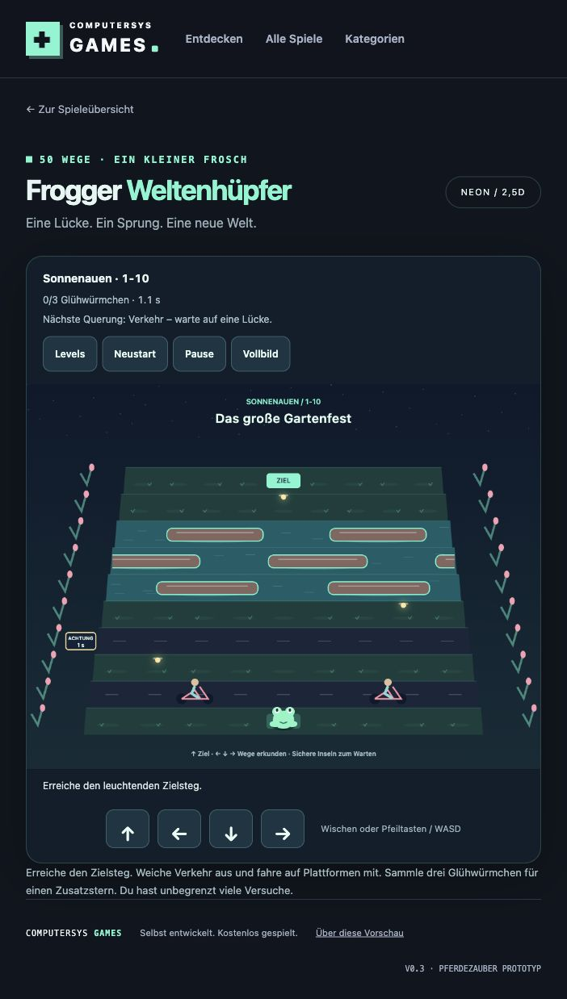
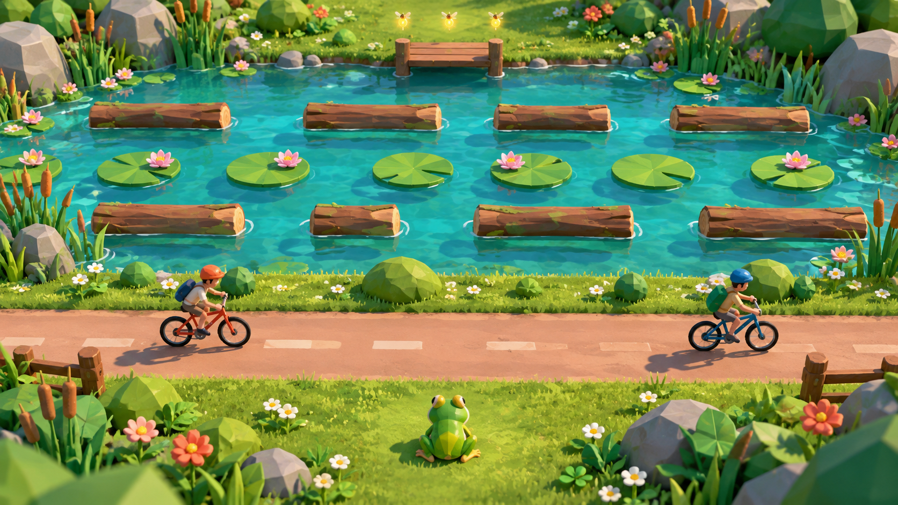
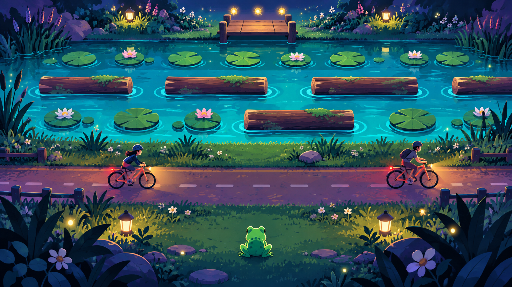
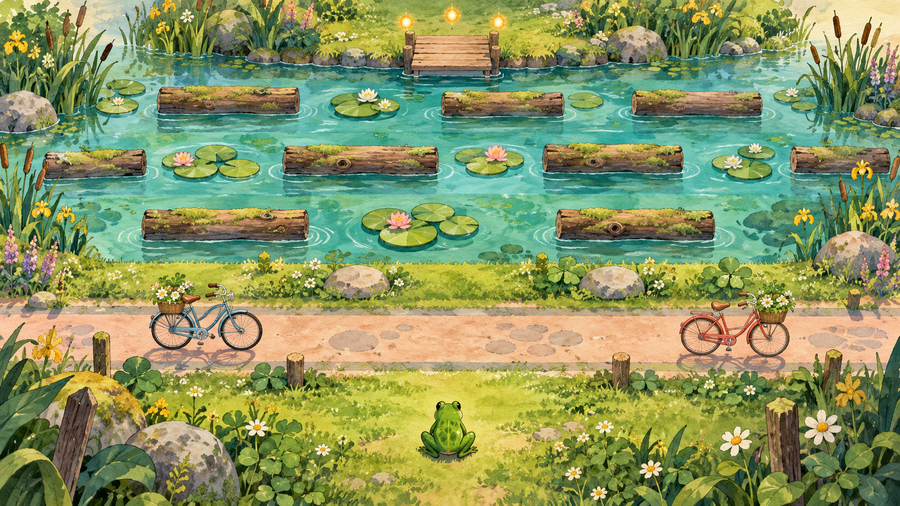

# Frogger – modernes Spielkonzept

Status: **Neon-Illustration in 2,5D mit Canvas 2D** (Variante B), bestätigt am 13. Oktober 2026. Die fünf Welten mit jeweils zehn festen Levels sind spielbar implementiert im PR #7; noch nicht veröffentlicht. [Implementierungsplan mit Milestones und GitHub-Issues](frogger-plan.md).

## Implementierungs- und Prüfstand

50 feste Karten, alle Hauptmechaniken, Rettungen, drei optionale Glühwürmchen je Level, Sterne, Bestzeiten und lineare Freischaltung sind umgesetzt. Pfeiltasten/WASD, vier Richtungsbuttons und Wischen steuern das Spiel; Escape und Pause halten die aktive Zeit an. Der vorhandene Vollbildcontroller wird verwendet. Fortschritt bleibt unter `cs-games:frogger:v1` auf dem aktuellen Gerät; fehlerhafter oder blockierter Speicher verhindert das Spielen nicht. Zurücksetzen verlangt eine Bestätigung. Nur abgeschlossene Levels werden gespeichert, keine laufenden Versuche.

Die Darstellung zeichnet Frosch, Verkehr, Plattformen, Pflanzen, Warnschilder und fünf Weltpaletten prozedural. Kleine Warnschilder werden durch lesbare Hinweise im HUD ergänzt. Das generierte Neon-Bild dient als Stilreferenz; die tatsächliche Spielgrafik ist eine einfachere, bewegliche Canvas-Zeichnung.

Screenshot aus einer getrennten lokalen QA-Seite mit freigeschalteten Testlevels und eigenem Speicherschlüssel; diese Testseite ist kein Bestandteil des Produktionsbuilds.

**Automatisiert:** 138 Node-Tests und neun Python-Uploadertests bestehen, ebenso Build und Projektcheck. Davon prüfen 75 Frogger-Tests unter anderem alle 50 Karten: ein zeitlich möglicher Weg mit allen Glühwürmchen und nötigen Rettungen, sichere Portalausgänge, Phasengrenzen, Verkehr, Plattformmitfahrt, Rutschen, Speicher, reduzierte Bewegung, Pause und Listenerabbau. Eine zusätzliche Read-only-Prüfung hat drei Lücken aufgedeckt; sie wurden korrigiert und erneut geprüft.

**Browser:** Levelabschluss per Tastatur, Freischaltung und Bestzeit nach Neuladen, Rücksetzbestätigung mit Abbruch, Pause einschließlich Plattform-Infodialog mit Escape-Rückkehr, Dialogfokus mit Tab/Shift+Tab, Richtungsbuttons und Wischgeste bis zum Ziel sowie Portalankunft auf beweglicher Plattform geprüft. Alle fünf Welten visuell geöffnet. Hochkant 390 × 844, Querformat 844 × 390 und Desktopansicht geprüft; Richtungsbuttons im Querformat sind 54 × 44 CSS-Pixel groß. Native Vollbildansicht und Rückkehr per Button/Escape geprüft. Browser-Konsole ohne Warnungen oder Fehler.

**Offen:** echte iPad-/Smartphone-Prüfung, mehrere Browser-Engines, belastbare Geräte-Performancewerte und Spielbalance mit menschlichen Testspielern. Der Solver weist die Lösbarkeit nach, nicht die passende Schwierigkeit. Bei künstlichem Viewport-Wechsel in nativer Vollbildansicht zeigte der Testbrowser eine skalierte Ansicht; Vollbild ohne Viewport-Override funktioniert. Reale Drehung im nativen Vollbild gehört deshalb ausdrücklich zur Geräteabnahme. Issue #15 und M6 bleiben bis zur Geräteabnahme offen. Kein Audio, kein Deployment und kein Merge.

## Spielidee

Ein kleiner Frosch sucht einen Weg durch eine Welt, die ständig in Bewegung ist. Das bekannte Prinzip bleibt sofort verständlich: in vier Richtungen hüpfen, Verkehr ausweichen, auf beweglichen Plattformen mitfahren und das sichere Ziel erreichen. Moderne Inszenierung, wechselnde Mechaniken und kurze, abwechslungsreiche Aufgaben geben jedem Level einen eigenen Charakter.

Arbeitstitel im Katalog: **Frogger – Weltenhüpfer**, Kategorie Arcade, vorgesehener Direktlink `#spiel/frogger`. Eigene Figuren, Grafiken, Sounds und Levelkarten entwickeln.

## Drei Grafikstile und Technologien

| Variante | Bildsprache | Technik und Einbindung | Abwägung |
| --- | --- | --- | --- |
| **A: Lebendige 3D-Dioramen** | Runde, plastische Low-Poly-Figuren, kleine Landschaften wie Spielzeugwelten, warme Farben, weiche Lichtverläufe, Wasserflächen und kurze Sprung-/Landeanimationen. Feste schräge Kamera ohne Kameradrehen. | Natives WebGL; vorhandene Erfahrung aus `src/games/pferdezauber.js` nutzen. Geometrie aus einfachen Formen, feste Kamera, wenige Materialien, Schatten zunächst als flache Formen. Keine zusätzliche Bibliothek. | Moderner Look und gut lesbare Wege. 3D-Grafik und Geräteprüfung kosten mehr Aufwand als 2D; die bestehende Pferdewelt ist kein fertiger allgemeiner Renderer. |
| **B: Neon-Illustration in 2,5D – gewählt** | Dunkles Petrol, Türkis und Koralle, leuchtende Konturen, glatte Formen, perspektivisch gestaffelte Straßen, Wasserringe und sparsame Partikel. Kein Pixelraster. | Canvas 2D mit schräger Projektion, lokal gehosteten Illustrationen und prozeduralen Effekten. An bestehende Canvas-Spiele und den Asset-Build anknüpfen. Die Simulation bleibt auf einem normalen Raster. | Voraussichtlich der kleinste technische Ausbau; passt zum Arcade-Auftritt. Beleuchtung und räumliche Tiefe werden gezeichnet, dadurch ist der Effektumfang begrenzt. |
| **C: Animiertes Bilderbuch** | Handgemalte Landschaften, Papiertexturen, üppige Pflanzen, expressive Frosch-Sprites, Aquarellwasser und sanftes Hintergrund-Parallax. Alle fünf Welten wirken wie Kapitel einer Reise. | Canvas 2D mit lokalen PNG-Sprite-Atlanten und getrennten Hintergrund-/Spielfigurenebenen. Vorhandene Sprite- und Asset-Muster aus Schneckenkampf nutzen. | Besonders charaktervoll und freundlich. Aufwand liegt vor allem bei konsistenten Illustrationen und Animationen; Bildgrößen und Ladezeiten müssen begrenzt werden. |

Variante B gilt für alle fünf Welten. A und C bleiben als verworfene Alternativen dokumentiert; es werden weder drei Renderer noch ein Stilumschalter gebaut. Die Aufwandseinschätzung ist eine Einschätzung anhand des Repositorys, kein bereits gemessener Vergleich.

Das Neon-Konzeptbild ist die visuelle Referenz: dunkle Petrolflächen, türkisfarbenes Wasser, korallfarbene Akzente, sanfte Leuchtkonturen und eine feste schräge Ansicht. Die Welten behalten ihre eigene Farb- und Landschaftssprache, bekommen aber dieselbe klare Neon-Zeichnung. Gefahren und Landeflächen bleiben auch ohne Leuchteffekte lesbar. Umsetzung mit Canvas 2D und vorhandenen Asset-Mustern, ohne zusätzliche Grafikbibliothek.

Technische Grundlagen: [Canvas API – MDN](https://developer.mozilla.org/en-US/docs/Web/API/Canvas_API) beschreibt die 2D-Zeichen-API; [WebGL API – MDN](https://developer.mozilla.org/en-US/docs/Web/API/WebGL_API) beschreibt browserbasierte, hardwarebeschleunigte 2D-/3D-Grafik. Konkrete Bildrate, Qualität und Geräteunterstützung müssen am Prototyp geprüft werden.

## Konzeptbilder zur Stilwahl

Alle drei Bilder zeigen eine vergleichbare Sonnenauen-Szene mit Frosch, Fahrradweg, Teichquerung und Zielsteg. Mit dem eingebauten Imagegen-Tool erzeugte Illustrationen; keine Screenshots oder zugesicherte Renderqualität der späteren Umsetzung. [Verwendete Prompts](frogger-concepts/prompts.md).

### A: Lebendige 3D-Dioramen

### B: Neon-Illustration in 2,5D – gewählte Referenz

### C: Animiertes Bilderbuch

## Gemeinsame Spielregeln

- Ein Tastendruck oder Wisch entspricht einem Raster-Schritt; Animation und Kollisionsprüfung folgen derselben Position. Pfeiltasten/WASD und vier große Touch-Richtungstasten bieten die vollständige Steuerung. Touch-Buttons bleiben auch ohne Wischgesten bedienbar.
- Standardziel: den gegenüberliegenden sicheren Ausgang erreichen. Rettungslevels verlangen vorher einen markierten Froschfreund; er folgt als rein visuelle Figur ohne eigene Kollisionsfläche. Drei optionale Glühwürmchen je Level belohnen riskante Umwege.
- Normalerweise etwa 45–90 Sekunden pro erfolgreichem Durchlauf als Designziel. Kein verpflichtendes Zeitlimit; Zeitwertung zählt nur aktive Spielzeit. Unbegrenzte Versuche und sofortiger Levelneustart halten die Hürde niedrig.
- Jede Welt hat eine neue Hauptmechanik. Level 1 führt sie sicher ein, 2–4 üben sie, 5 kombiniert bekannte Elemente, 6–9 variieren sie und 10 bildet ein Abschlusslevel. Abschluss eines Levels öffnet das nächste; Level 10 öffnet die nächste Welt, ohne Sternpflicht.
- Pro Level bis zu drei Sterne: einer für das Ziel, einer für alle drei Glühwürmchen, einer für das Ziel innerhalb einer levelabhängigen Richtzeit. Glühwürmchen werden beim Neustart zurückgesetzt; gespeicherte Sterne können durch Wiederholen nur verbessert werden.
- Sichere Wartezonen und Vorwarnungen machen Gefahren planbar. Jede Karte muss mit den vorgesehenen Bewegungszeiten lösbar sein; Dekoration darf weder Hindernisse noch Landeflächen verdecken. Rückwärtshüpfen bleibt erlaubt.
- Pause, Neustart, Welt-/Levelauswahl und Vollbild über die vorhandene Plattform. Bei verborgenem Tab pausiert die Simulation, damit die Rückkehr keinen Treffer auslöst.
- Fortschritt, Sterne und Bestzeiten lokal speichern, ohne Konto oder Server. Ungültige Speicherdaten validieren; bei gesperrtem Speicher bleibt das Spiel spielbar und zeigt einen Hinweis. Rücksetzen nur nach ausdrücklicher Bestätigung im Spiel.
- Gefahren zusätzlich durch Form, Muster und Bewegung erkennbar machen. Menüs mit Tastatur und sichtbarem Fokus bedienen; reduzierte Bewegung schaltet dekorative Kamerabewegung und Partikel ab. Kein Blitzen und kein verpflichtendes Bildschirmwackeln.

## Welt 1: Sonnenauen

Warme Gartenlandschaft mit Kieswegen, Schilf, Teichen und kleinen Holzstegen. Hauptmechanik: **mitfahrende Baumstämme**. Die ersten Levels erklären Hüpfen, Warten und seitliches Nachjustieren.

| Level | Name | Aufgabe und neue Herausforderung |
| --- | --- | --- |
| 1-01 | Der erste Sprung | Über sichere Grasinseln zum Teichrand; Richtung und Ziel kennenlernen. |
| 1-02 | Fahrradweg | Zwei langsame Fahrräder passieren, die erste sichere Mittelinsel nutzen. |
| 1-03 | Treibholz | Auf einen breiten, langsamen Stamm springen und am gegenüberliegenden Ufer abspringen. |
| 1-04 | Gegen den Strom | Zwei Stammreihen fahren in Gegenrichtungen; die Landung seitlich vorbereiten. |
| 1-05 | Picknickverkehr | Fahrradweg und Bach hintereinander überwinden, mit einer Rastinsel dazwischen. |
| 1-06 | Seerosenpfad | Zwischen festen Seerosen und schmaleren Stämmen wechseln; Glühwürmchen abseits sammeln. |
| 1-07 | Entenparade | Eine sichtbar angekündigte Entengruppe sperrt kurz einen Steg; in einer Bucht warten. |
| 1-08 | Inselhüpfen | Mehrere kurze Querungen über versetzte Inseln; seitliche Schritte gezielt nutzen. |
| 1-09 | Kleiner Freund | Einen Froschfreund auf der Seiteninsel abholen und gemeinsam zum markierten Ausgang gelangen. |
| 1-10 | Das große Gartenfest | Fahrradkolonnen, Enten und drei Stammreihen als Abschluss kombinieren. |

## Welt 2: Neonhafen

Eine lebendige Küstenstadt bei Abendlicht: reflektierende Straßen, Marktstände, leuchtende Fähren. Hauptmechanik: **vorhersehbare Ampelphasen**. Hindernisse bleiben auch ohne Leuchteffekte klar sichtbar.

| Level | Name | Aufgabe und neue Herausforderung |
| --- | --- | --- |
| 2-01 | Grün heißt los | Eine Straße mit langer Grünphase überqueren; Countdown und Ampelsymbole kennenlernen. |
| 2-02 | Feierabendspur | Zwei unterschiedlich schnelle Fahrspuren mit sicherer Verkehrsinsel passieren. |
| 2-03 | Straßenbahn | Ein Warnsignal kündigt die Bahn an; zwischen Straße und Gleis warten können. |
| 2-04 | Hafentaxi | Breite Boote als bewegliche Plattformen nutzen; das Ufer bleibt der sichere Ausstieg. |
| 2-05 | Marktgasse | Lieferwagen und Ampelquerung kombinieren; Stände begrenzen die seitliche Route. |
| 2-06 | Zwei Kreuzungen | Versetzte Ampelphasen über zwei Straßen lesen; jede hat eine eigene Wartezone. |
| 2-07 | Nachtfähre | Auf eine Fähre wechseln, die länger am Anleger hält, dann zur Zielplattform fahren. |
| 2-08 | Blaulicht | Ein angekündigter Einsatzwagen fährt während der sonst sicheren Ampelphase; Symbole warnen zusätzlich. |
| 2-09 | Dachgarten-Rettung | Einen Freund auf einer erhöht dargestellten, logisch ebenen Terrasse über einen Seitengang abholen. |
| 2-10 | Letzte Fähre | Kreuzung, Straßenbahn und Fähren in einer langen Hafenquerung verbinden; kein harter Zeitablauf. |

## Welt 3: Dschungelruinen

Üppiger Regenwald mit türkisfarbenen Flüssen, alten Steinwegen und riesigen Blättern. Hauptmechanik: **zeitweise versinkende Plattformen**, deren Zustand durch Blattfaltung und Symbole angekündigt wird.

| Level | Name | Aufgabe und neue Herausforderung |
| --- | --- | --- |
| 3-01 | Das atmende Blatt | Ein einzelnes sinkendes Blatt zwischen zwei sicheren Ufern überqueren. |
| 3-02 | Wasserfallweg | Drei Blattplattformen mit großzügigen, versetzten Standzeiten passieren. |
| 3-03 | Ameisenstraße | Lücken in einer Ameisenkolonne auf einem trockenen Pfad abwarten. |
| 3-04 | Lianenfloß | Ein mitfahrendes Floß erreichen, bevor ein vorgeschaltetes Blatt sinkt. |
| 3-05 | Tempeltor | Über eine Blattkette und eine trockene Ameisenquerung zum Ruineneingang gelangen. |
| 3-06 | Krokodilbucht | Sichere Holzflöße von Krokodilen unterscheiden; Augen und Rückenform kennzeichnen die Gefahr. |
| 3-07 | Regenpause | Ein angekündigter Regenschauer beschleunigt Floßreihen zeitweise; Steininseln geben Schutz. |
| 3-08 | Drei Rhythmen | Blattgruppen in drei unterschiedlichen Zyklen über sichere Zwischensteine verbinden. |
| 3-09 | Der verlorene Forscher | Einen Froschfreund im Seitenhof retten; Rückweg über einen anderen Blattzyklus planen. |
| 3-10 | Herz des Dschungels | Floßfahrt, sinkende Blätter und Krokodilbucht zum großen Tempelhof kombinieren. |

## Welt 4: Polarlichter

Eisblaue Seen, verschneite Hütten und ruhige Polarlichtbänder. Hauptmechanik: **Rutschen auf markierten Eisfeldern**. Ein Sprung aufs Eis führt genau ein zusätzliches Feld in Sprungrichtung weiter, bis Schnee oder ein Fangfeld stoppt.

| Level | Name | Aufgabe und neue Herausforderung |
| --- | --- | --- |
| 4-01 | Rutschschule | Auf einer sicheren Übungsfläche die Zusatzbewegung kennenlernen; Schneefelder fangen den Frosch auf. |
| 4-02 | Schneespuren | Eisfelder und Schneefelder zu einer kontrollierten Route verbinden. |
| 4-03 | Schlittenweg | Schlittenkolonnen überqueren; vor der Straße auf einem Schneefeld stoppen. |
| 4-04 | Schollenfahrt | Breite treibende Eisschollen nutzen; nur eigens markierte Flächen lösen Rutschen aus. |
| 4-05 | Dünnes Eis | Rutschfelder vor einer Blatt-ähnlichen, angekündigt brechenden Eisplattform kombinieren. |
| 4-06 | Frostkurve | Aufeinanderfolgende Rutschabschnitte mit seitlich versetzten Schneefeldern navigieren. |
| 4-07 | Schneepflug | Ein breiter, langsam fahrender Pflug erzwingt eine größere Lücke auf der Querung. |
| 4-08 | Windfenster | Ein sichtbarer Windsack kündigt an, wann die Schollenfahrt schneller wird; an Land abwarten. |
| 4-09 | Wärme für zwei | Einen Freund an einer Hütte abholen und über Eis- und Schlittenabschnitte zurückführen. |
| 4-10 | Unter dem Polarlicht | Rutschroute, brechendes Eis und Schollenfahrt zu einer großen Seequerung verbinden. |

## Welt 5: Orbitalgarten

Eine Pflanzenstation im All mit Glasbiomen, schwebenden Frachtschlitten und Blick auf einen farbigen Planeten. Hauptmechanik: **paarweise verbundene Teleportfelder** mit eindeutigen Symbolen. Kamera und Steuerachsen bleiben unverändert.

| Level | Name | Aufgabe und neue Herausforderung |
| --- | --- | --- |
| 5-01 | Portalprobe | Ein markiertes Portalpaar verbindet zwei sichere Plattformen; Zielvorschau erklärt den Ausgang. |
| 5-02 | Frachtring | Roboterschlitten auf zwei Bahnen ausweichen; die vertraute Verkehrsmechanik im All. |
| 5-03 | Satellitensteg | Auf beweglichen Wartungsplattformen zwischen zwei Stationsteilen mitfahren. |
| 5-04 | Zwei Verbindungen | Zwei verschieden markierte Portalpaare sinnvoll nacheinander nutzen. |
| 5-05 | Gewächshaus-Schleuse | Portalweg und angekündigte Schleusenphasen kombinieren; vor jedem Tor liegt eine sichere Insel. |
| 5-06 | Solarfenster | Querende Energiebalken passieren; Kontur und Countdown zeigen ihre Aktivphasen. |
| 5-07 | Umlaufbahn | Ein Portal führt auf eine große bewegliche Plattform; im sicheren Zielbereich weiterfahren. |
| 5-08 | Sternenroute | Zwischen kurzem Weg und längerem Glühwürmchen-Umweg über verschiedene Portalpaare wählen. |
| 5-09 | Die letzte Rettung | Einen Freund im Außenbiom abholen, dann Schleusen und Frachtring durchqueren. |
| 5-10 | Heimkehr | Das Finale verbindet Portalpaare, Plattformfahrt und angekündigte Sperren; die ganze Reise endet im Orbitalgarten. |

Teleportation erfolgt nur beim Betreten und löst am Ausgang nicht unmittelbar erneut aus. Portalausgänge sind immer sichere Felder. Bewegliche Ausgangsplattformen brauchen einen festen, gefahrlosen Ankunftsbereich. So bleibt die Mechanik nachvollziehbar und erzeugt keine unvermeidbaren Treffer.

## Umsetzung im vorhandenen Projekt

Die Umsetzung begann mit Sonnenauen 1-01 bis 1-03 und wurde in Milestone-Commits zur kompletten 50-Level-Kampagne erweitert. Der Prüfstand oben unterscheidet implementierte Funktionen von ausstehender Geräte- und Balanceabnahme.

Die Integration erreicht diese Stellen:

| Stelle | Vorgesehene Änderung |
| --- | --- |
| `src/games/` | Frogger-Simulation, Leveldefinitionen und gewählte Darstellung; bestehende Spiel-Factory mit `start`, `pause`, `reset`, `dispose`. Nur tatsächlich nötige Aufteilung. |
| `src/catalog.js` | Ein Spiel mit ID `frogger`, Beschreibung und Custom-Steuerung eintragen. |
| `src/art.js` | Eine passende Katalogvorschau ergänzen. |
| `scripts/build.js` | Spielquellen in Ladefolge und gegebenenfalls lokale Bildassets aufnehmen. Bestehendes Asset-Manifest und Hash-Verfahren verwenden. |
| `src/app.js`, `src/session.js`, `src/fullscreen.js` | Vorhandene Schnittstellen für Start, Ende, Pause und Vollbild verwenden; nur erweitern, wenn die Integration es erfordert. Eigene Sterne-/Levelanzeige innerhalb des Spiels. |
| `tests/` | Schritte, Kollisionszeitpunkt, Plattformmitfahrt, deterministische Levelphasen, Eis-Zusatzschritt, Portalankunft und Speichervalidierung prüfen. Alle 50 Level-IDs und ihre Verweise validieren. |
| `README.md`, `docs/frogger.md` | Nur tatsächlich implementierte Funktionen und deren Prüfstand dokumentieren. |

Fortschritt erhält einen eigenen versionierten Speicherschlüssel (`cs-games:frogger:v1`). Bestehende Bestwerte und Spielstände anderer Spiele werden nicht überschrieben. Eingaben, Timer und Rendering werden beim Spielwechsel entfernt. Spiellogik und Gefahrenphasen verwenden aktive Spielzeit; Pause und Neustart dürfen ihre Synchronisation nicht verschieben.

## Abnahmekriterien

- Genau fünf Welten und zehn auswählbare Levels je Welt; Freischaltung funktioniert, jedes Level hat eine geprüfte, zeitlich mögliche Route.
- Alle Weltmechaniken lassen sich per Tastatur und Touch bedienen; Ziel, Wartezonen und Gefahren sind im gewählten Stil gut lesbar.
- Kollisionsprüfungen berücksichtigen schnelle Fahrzeuge zwischen zwei Simulationsschritten; schwankende Bildrate ändert die Spielgeschwindigkeit nicht. Treffer stoppen den Versuch unmittelbar, ohne nachträgliche Sterne zu vergeben.
- Pause, Tabwechsel, Neustart, Vollbild, Drehen des Geräts und Wechsel zu einem anderen Spiel funktionieren ohne weiterlaufende alte Timer oder verlorene Eingaben.
- Fortschritt und Sterne bleiben bei Neuladen erhalten; blockierter oder beschädigter LocalStorage verhindert das Spielen nicht.
- `npm test`, Python-Uploadertests, Build und Projektcheck bestehen. Zusätzlich Browserprüfung am Desktop und echte Touch-Prüfung auf iPad und Smartphone; Bildrate und Lesbarkeit werden dabei gemessen statt angenommen.

## Bewusst ausgelassen

Kein Multiplayer, kein Konto, keine Online-Bestenliste, kein Shop, kein Levelgenerator und kein frei steuerbares 3D-Kamerasystem. Audio gehört nicht zum ersten Ausschnitt; die Regeln müssen ohne Ton verständlich sein. Spätere Sounds benötigen eine eigene Umsetzung und passende Assets. Veröffentlichung erfolgt über den vorhandenen manuellen Freigabeprozess.

Dieser PR liefert Stilentscheidung, Konzeptbilder, Plan, GitHub-Issues und die spielbare Kampagne. Balance und echte Geräteabnahme bleiben offen; die Veröffentlichung benötigt eine separate Freigabe.
